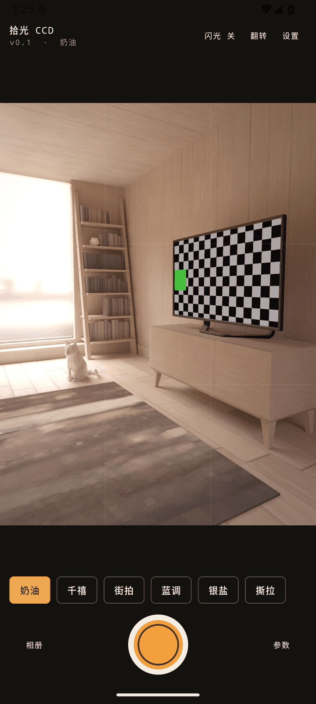
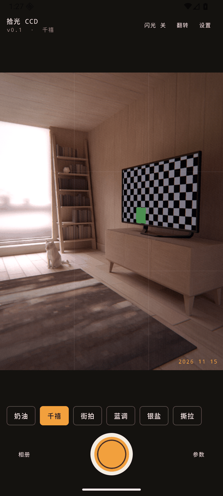
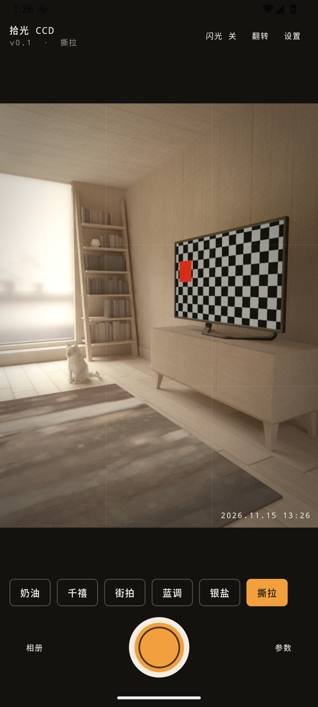
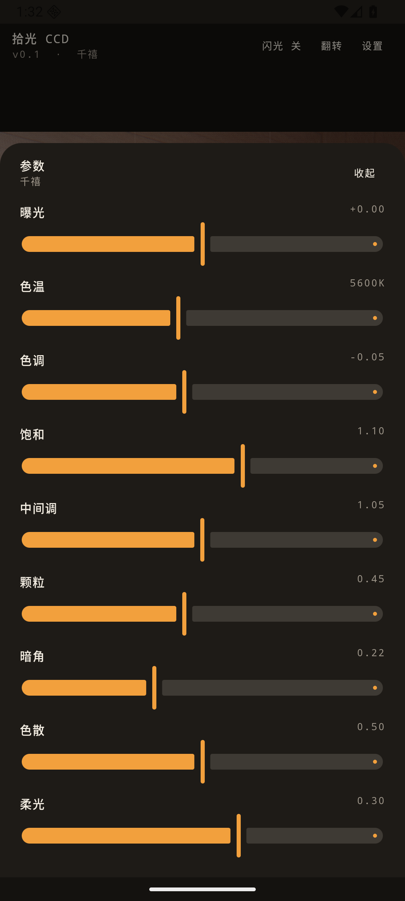
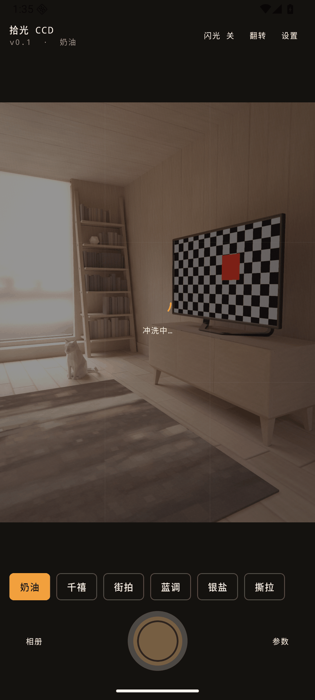
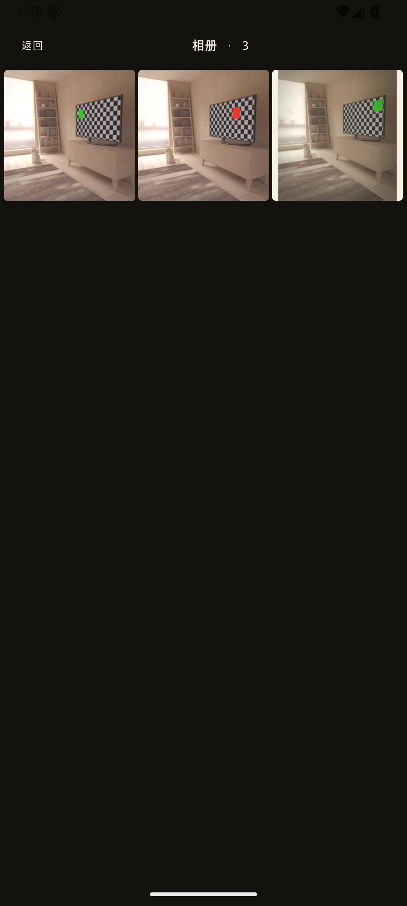
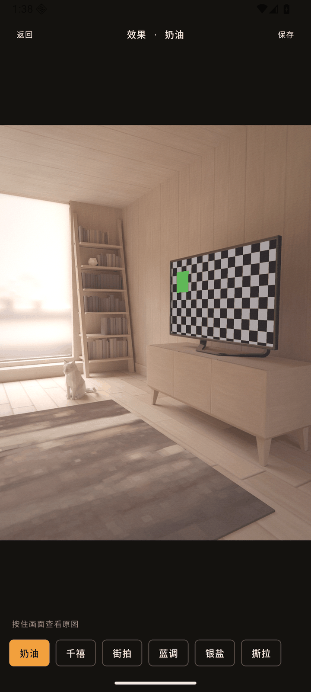
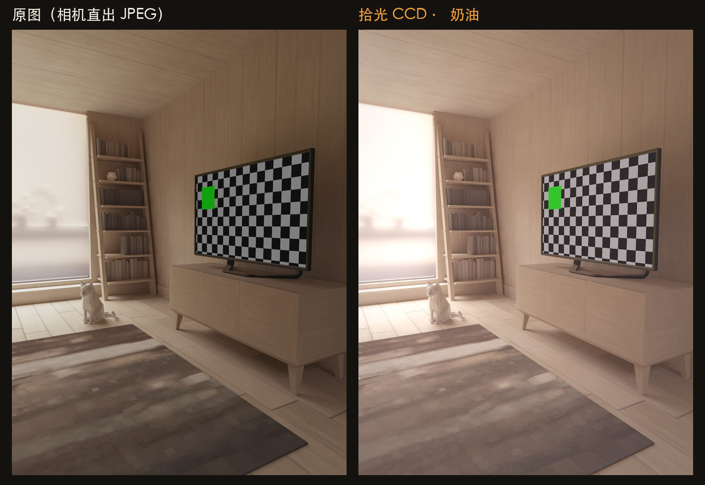

# Shiguang CCD (Android)

English | [简体中文](README.md)


A **from-scratch** Android camera app that recreates the look of early-2000s CCD
compact cameras: real-time GPU filters, six built-in presets, ten adjustable
parameters, and a gallery editor.

It is not a clone of ProCCD, and it contains no code, LUTs, UI assets, or sounds
from any third-party camera app.

- Package: `app.shiguang.ccd`
- Version: 0.1.0 (versionCode 1)
- Min SDK: 26 (Android 8.0), arm64
- Rendering: OpenGL ES 3.0
- Permissions: `CAMERA` only — **no network permission**

## Screenshots

| Viewfinder · Cream | Viewfinder · Y2K | Viewfinder · Peel |
|---|---|---|
|  |  |  |

| Parameters | Developing | Gallery |
|---|---|---|
|  |  |  |

| Editor (re-grades from the original) | Before / after |
|---|---|
|  |  |

All screenshots come from an Android 16 (API 36) emulator's virtual scene and
only prove the pipeline; real devices look much better.

## Features

- **Live filtered viewfinder** — CameraX `SurfaceProcessor` plus a hand-written
  OpenGL ES 3.0 pipeline (scene → highlight extraction → two-pass blur →
  composite). What you see is what you get.
- **Six presets** — Cream, Y2K, Street, Blue, Mono, Peel.
- **Ten parameters** — exposure, temperature, tint, saturation, midtones,
  grain, vignette, chromatic aberration, bloom, sharpness. Live updates,
  resettable, saveable as a custom preset.
- **Capture** — flash (off/on/auto), front/back camera, 3:4 preview that matches
  the output, EXIF rotation, a short "developing" animation, MediaStore save.
- **Timestamps and borders** — orange LED or white digital date stamp, plus a
  peel-apart paper border.
- **Gallery and editor** — reads `Pictures/拾光CCD`, re-grades imported photos,
  press-and-hold to compare with the original, saves a copy. The untouched JPEG
  of every shot is kept inside the app, so re-editing never stacks filters.

## Build

```bash
cd ccd-cam-android
source scripts/env.sh
./gradlew :app:assembleDebug
```

Outputs:

- `app/build/outputs/apk/debug/app-debug.apk`
- Delivery copy: `dist/拾光CCD-0.1.0-debug.apk`

`scripts/env.sh` handles two quirks of the original development machine:

1. `~/.gradle` and `~/.android` are read-only there, so Gradle user home and AVD
   state live inside the project (`.gradle-home/`, `.android-home/`), and Kotlin
   compiles in-process.
2. The shared SDK's API 36 system image is incomplete, so `.android-sdk/`
   symlinks the tools and installs a complete system image separately.

On a normal machine you can simply run `./gradlew :app:assembleDebug`.

## Run on an emulator

```bash
source scripts/env.sh
./scripts/emulator.sh &      # creates the AVD on first run
./scripts/smoke.sh           # install, grant camera, launch, screenshot, crash check
```

Install the system image once if needed:

```bash
yes | sdkmanager --sdk_root="$PWD/.android-sdk" "system-images;android-36;google_apis;arm64-v8a"
```

## Tests

```bash
./gradlew :imaging:test                    # colour maths, tone curve, presets, JSON
./gradlew :app:connectedDebugAndroidTest   # GL rendering, timestamp/border, gallery I/O
```

If `connectedDebugAndroidTest` cannot fetch Google's test-platform gRPC
dependencies on your network, run the instrumentation directly:

```bash
adb install -r app/build/outputs/apk/debug/app-debug.apk
adb install -r app/build/outputs/apk/androidTest/debug/app-debug-androidTest.apk
adb shell am instrument -w -r app.shiguang.ccd.test/androidx.test.runner.AndroidJUnitRunner
```

Verified for this release: 17 JVM unit tests and 9 instrumented tests pass on an
API 36 emulator (GL identity render, mono preset, all six presets, timestamp,
paper border, gallery write/query/read).

## Project layout

```
app/            UI, CameraX, GL renderer, storage
imaging/        pure Kotlin colour maths, parameter model, presets (unit-testable)
scripts/        env.sh / emulator.sh / smoke.sh
docs/           design notes, feature parity, screenshots
dist/           local APK copy (git-ignored)
.github/        CI: build debug APK, attach it to tag releases
```

## Known limitations (v1)

- Capture and import only: **no video, no collage/stickers, no Live Photo, no
  beauty mode**.
- Portrait only; the viewfinder is fixed at 3:4.
- On Android 8/9 photos go to the app-private folder and do not appear in the
  system gallery.
- The emulator renders with SwiftShader, so one shot takes 20–30 seconds; real
  GPUs finish in a few hundred milliseconds.
- Editing always re-grades from the in-app original JPEG. If that original is
  missing (or "keep original" is off), the finished photo is re-processed and
  the look stacks.
- Front-camera mirroring is handled in texture space. Some vendor HALs already
  mirror front JPEGs; the saved photo follows whatever the HAL delivers.

## Privacy

No network, no analytics, no uploads. Photos are written to `Pictures/拾光CCD`
on the device.

## License

MIT. The repository contains no third-party image assets or commercial app
resources.
