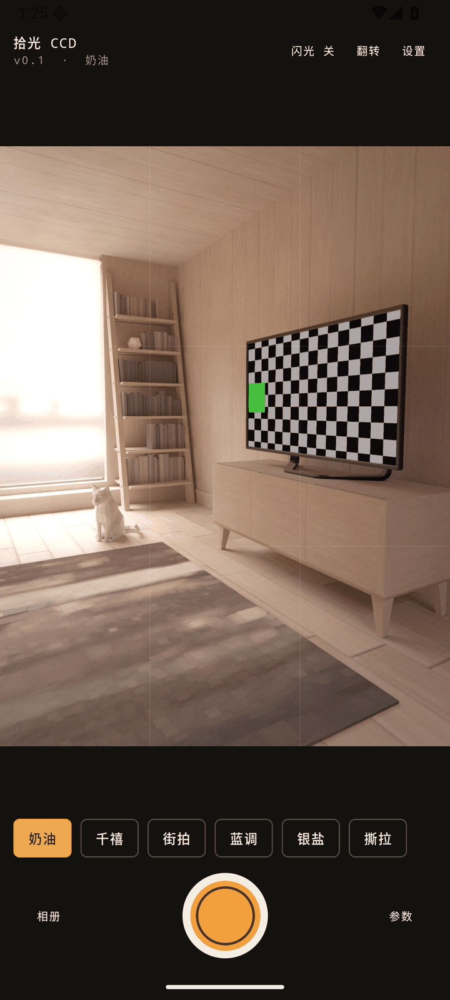
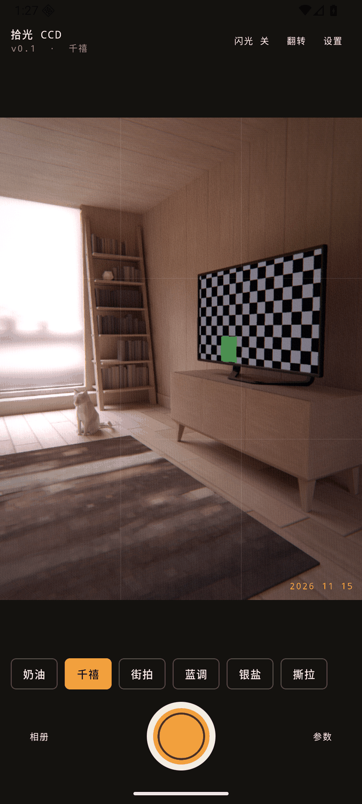
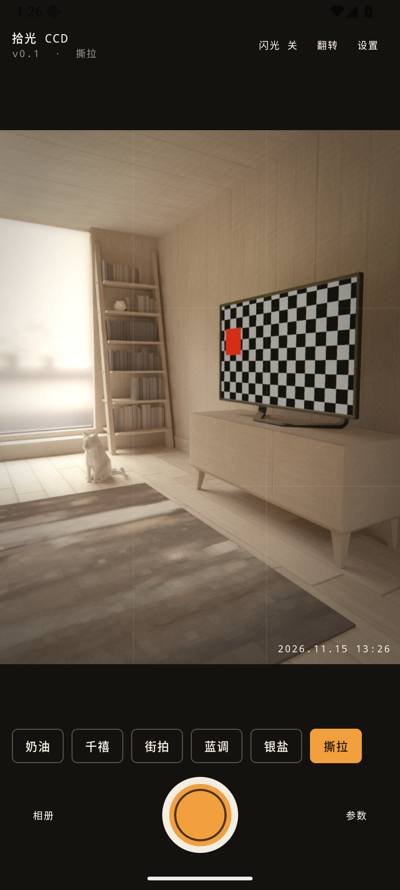
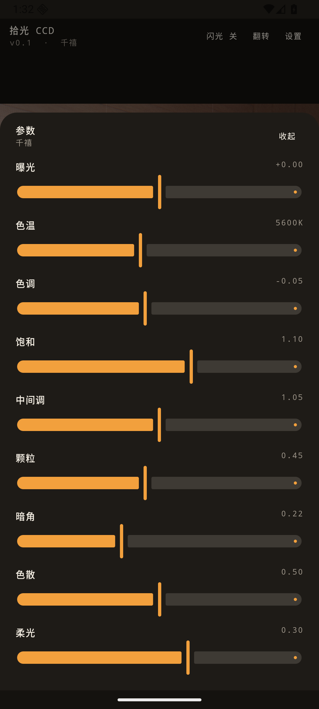
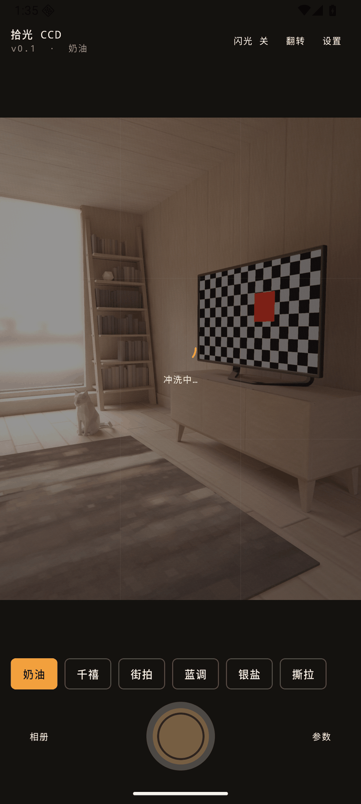
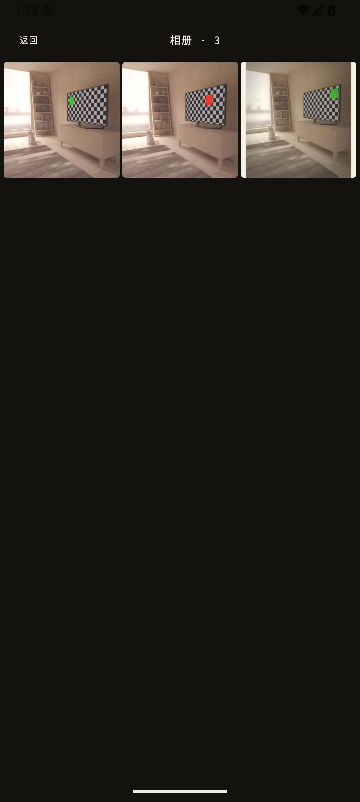
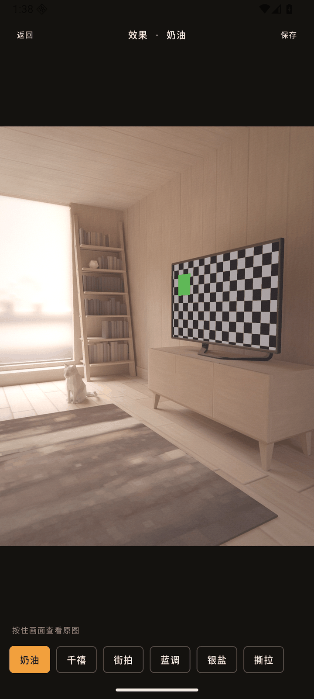
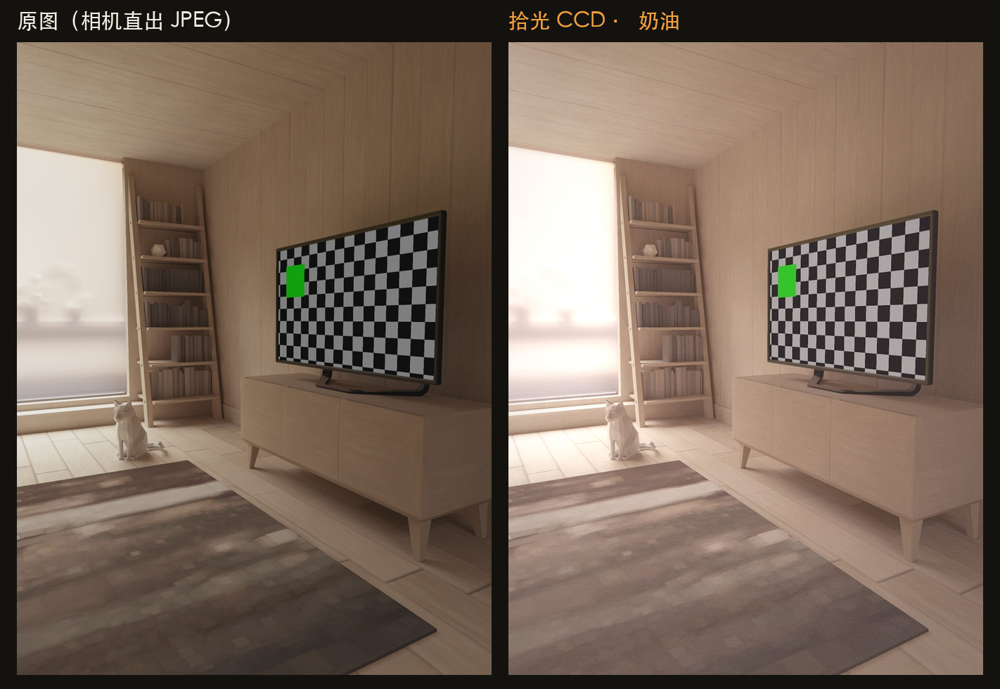

# 拾光 CCD（Android）

[English](README.en.md) | 简体中文


一个**自研**的 CCD 风格相机 App：实时 GPU 滤镜、6 个内置预设、10 项参数微调、相册导入编辑。
不是 ProCCD 的复制品，也没有使用任何第三方相机 App 的代码、滤镜 LUT、UI 素材或音效。

- 包名：`app.shiguang.ccd`
- 版本：0.1.0（versionCode 1）
- 最低系统：Android 8.0（API 26），arm64
- 渲染：OpenGL ES 3.0
- 权限：仅 `CAMERA`；**不申请网络权限**

## 功能

- **实时滤镜取景**：CameraX `SurfaceProcessor` + 自研 GL 管线，取景画面就是成片效果。
- **6 个预设**：奶油 / 千禧 / 街拍 / 蓝调 / 银盐 / 撕拉。
- **参数面板**：曝光、色温、色调、饱和、中间调、颗粒、暗角、色散、柔光、清晰度；可重置、可存为新预设。
- **拍摄**：闪光灯（关/开/自动）、前后摄切换、4:3 取景、拍后「冲洗中」动效。
- **时间戳与边框**：橙色 LED 日期戳、白色数码日期戳、撕拉白边。
- **相册**：读取 `Pictures/拾光CCD`，支持导入照片重新套滤镜、长按对比原图、保存副本。

## 截图

| 取景 · 奶油 | 取景 · 千禧 | 取景 · 撕拉 |
|---|---|---|
|  |  |  |

| 参数面板 | 冲洗中 | 相册 |
|---|---|---|
|  |  |  |

| 编辑（从原图重新套滤镜） | 前后对比 |
|---|---|
|  |  |

截图均来自 Android 16（API 36）模拟器的虚拟场景，仅用于验证链路，真机观感会更好。

## 构建

```bash
cd ccd-cam-android
source scripts/env.sh
./gradlew :app:assembleDebug
```

产物：

- `app/build/outputs/apk/debug/app-debug.apk`
- 交付副本：`dist/拾光CCD-0.1.0-debug.apk`

> 本机环境有两处特殊处理，`scripts/env.sh` 已经封装：
> 1. 沙箱下 `~/.gradle`、`~/.android` 不可写，因此 Gradle user home 与 AVD 目录都放在项目内（`.gradle-home/`、`.android-home/`）。
> 2. `~/Library/Android/sdk` 自带的 API 36 系统镜像不完整（缺 `system.img`），所以项目内 `.android-sdk/` 以软链复用共享 SDK 的工具，只单独安装完整系统镜像。

## 在模拟器运行

```bash
source scripts/env.sh
./scripts/emulator.sh &      # 首次运行会自动创建 AVD（需要已安装系统镜像）
./scripts/smoke.sh           # 安装、授权、启动、截图、检查崩溃
```

系统镜像安装命令（只需一次）：

```bash
yes | sdkmanager --sdk_root="$PWD/.android-sdk" "system-images;android-36;google_apis;arm64-v8a"
```

## 测试

```bash
./gradlew :imaging:test                    # 色彩数学、曲线、预设、序列化（JVM）
./gradlew :app:connectedDebugAndroidTest   # GL 渲染、时间戳/边框、相册读写（需模拟器）
```

如果 `connectedDebugAndroidTest` 因网络无法拉取 Google 测试平台的 gRPC 依赖，可以直接用 adb 跑：

```bash
adb install -r app/build/outputs/apk/debug/app-debug.apk
adb install -r app/build/outputs/apk/androidTest/debug/app-debug-androidTest.apk
adb shell am instrument -w -r app.shiguang.ccd.test/androidx.test.runner.AndroidJUnitRunner
```

本次交付的验证结果：JVM 单测 17 条通过；仪器测试 9 条通过（GL 身份渲染、黑白预设、6 预设渲染、时间戳、白边、相册写入/查询/读取等）。


## CI 与发布

GitHub Actions 在 push 到 `main`、提 PR、或手动触发时运行单测并构建 debug APK，产物可从
Actions 的 artifact 下载；推送 `v*` 标签时，APK 会自动附到对应的 GitHub Release。

```bash
git tag v0.1.0
git push origin v0.1.0
```

## 目录结构

```
app/            UI、CameraX、GL 渲染、存储
imaging/        纯 Kotlin 色彩数学、参数模型、预设（可单测）
scripts/        env.sh / emulator.sh / smoke.sh
docs/           设计说明、功能对照、截图
dist/           交付用 APK 副本
```

## 已知限制（v1）

- 只做拍照与导入编辑：**没有录像、拼图贴纸、Live Photo、美颜**。
- 竖屏锁定；不支持横屏构图。
- Android 8/9 上照片保存到应用私有目录，系统相册不会显示。
- 模拟器用 SwiftShader 做 GPU 渲染，单张处理约 20–30 秒；真机为几百毫秒级。
- 编辑始终从「原图」（应用内保存的原始 JPEG）重新渲染，不会叠加滤镜；若原图丢失则退化为对成片再处理。
- 前置镜像在纹理空间应用，取景与成片方向一致；个别厂商 HAL 的镜像行为可能不同，若遇异常请反馈机型。
- 模拟器的虚拟场景画面很「假」，效果请以真机或导入样片为准。
- 前摄预览与成片的镜像行为依赖设备相机 HAL，个别机型可能需要在参数里微调。

## 隐私

不联网、不收集数据、不上传照片。照片只写入本机 `Pictures/拾光CCD`。

## 许可

自有代码以 MIT 许可发布；仓库不包含任何第三方图像素材或商业 App 资源。
